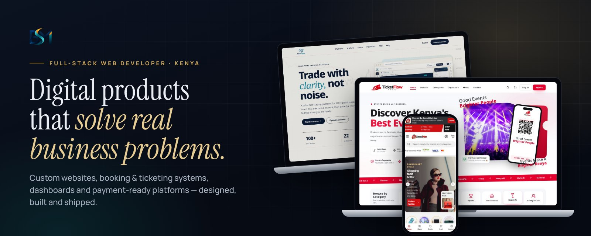
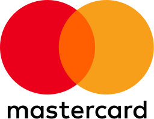
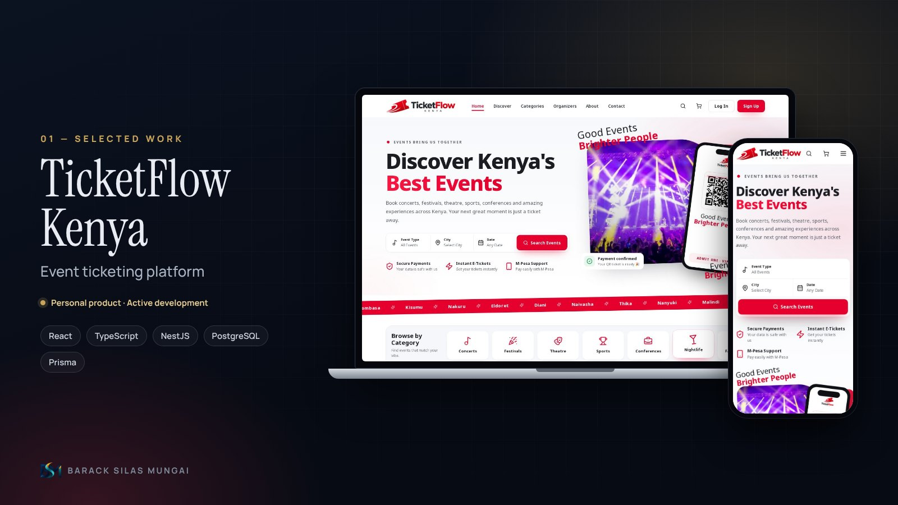
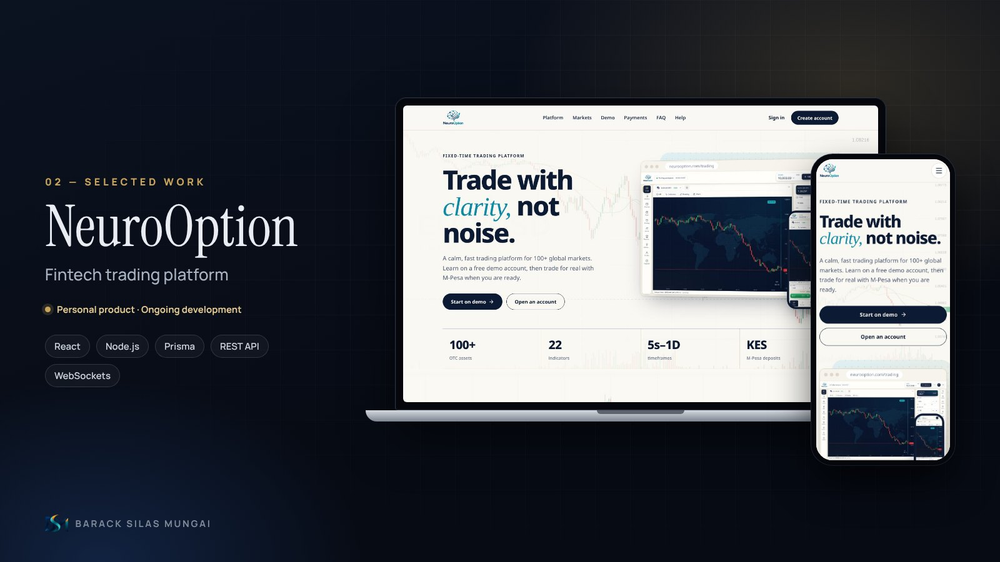
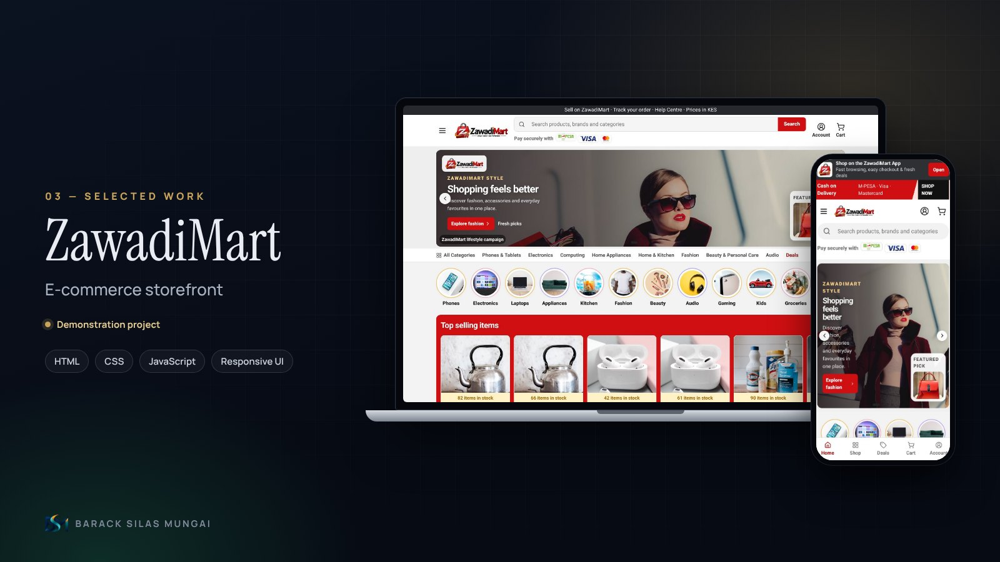

# Barack Silas Mungai

**Full-Stack Web Developer · Business Systems · UI/UX**

Based in Kenya · Working remotely worldwide · BBIT, Riara University

 

 

<table>
<tr>
<td align="center" width="200"><h3>3</h3>Products with live previews</td>
<td align="center" width="200"><h3>Full-stack</h3>Interface to database</td>
<td align="center" width="200"><h3>M-Pesa</h3>&amp; card payment flows</td>
<td align="center" width="200"><h3>1 day</h3>Typical reply time</td>
</tr>
</table>

<b>PAYMENTS I INTEGRATE</b>
  
&nbsp;&nbsp;&nbsp;&nbsp;&nbsp;
&nbsp;&nbsp;&nbsp;&nbsp;&nbsp;

---

## ✦ About

I'm **Barack Silas Mungai**, a Kenya-based web developer and BBIT student at Riara University. I design and build responsive business websites, web applications and custom systems that pair clean interfaces with dependable backend services.

<table>
<tr>
<td width="50%" valign="top">

**What I build**
- Custom websites &amp; business platforms
- Booking &amp; event-ticketing systems
- E-commerce stores with checkout
- Dashboards &amp; admin tools

</td>
<td width="50%" valign="top">

**How I work**
- REST APIs, auth &amp; role-based access
- M-Pesa &amp; card payment workflows
- Clear milestones &amp; remote collaboration
- Deployment, handover &amp; ongoing support

</td>
</tr>
</table>

---

## ✦ Selected Work

### 01 · TicketFlow Kenya
**Event ticketing platform** · `Personal product · Active development`

A platform for discovering events across Kenya, selling tickets and running organizer workflows — built for a mobile-first audience that pays with M-Pesa.

- Event discovery by category, city and date
- Ticket categories with QR-ticket workflow
- Customer accounts and organizer features
- Payment integration architecture (M-Pesa & cards)

    

[**Repository** ↗](https://github.com/silasbarack/ticketflow-kenya) · [**Live site** ↗](https://ticketflow-frontend-w47s.onrender.com)

### 02 · NeuroOption
**Fintech trading platform** · `Personal product · Ongoing development`

A fixed-time trading platform concept with live chart workspaces, a free demo account, user accounts and M-Pesa deposit flows.

- Real-time chart workspace and trading dashboard
- Demo and live accounts with authentication
- Account management and M-Pesa deposit flows
- Separate frontend and backend services

   

[**Frontend** ↗](https://github.com/silasbarack/neurooption-frontend) · [**Backend** ↗](https://github.com/silasbarack/neurooption-backend)

### 03 · ZawadiMart
**E-commerce storefront** · `Demonstration project`

A modern, responsive storefront demonstrating product browsing, cart and checkout presentation with Kenyan payment options.

- Product catalogue with category browsing
- Shopping cart and checkout presentation
- M-Pesa, Visa and Mastercard payment display
- Mobile-first responsive layout

  

[**Repository** ↗](https://github.com/silasbarack/zawadimart-premium)

<b>More projects</b>

 

| Project | Description | Links |
|---|---|---|
| **SafariStay Kenya** | Hotel booking demonstration with accommodation listings, discovery and responsive booking interfaces. *Demo project.* | [Repository](https://github.com/silasbarack/safaristay-kenya) · [Demo](https://safaristay-kenya.onrender.com) |
| **Personal Portfolio** | Website-development services portfolio with project case studies, enquiry forms, a sales pipeline and owner-side management. | [Repository](https://github.com/silasbarack/baracksilasmungai-) |

---

## ✦ Technologies & Tools

The logos below represent the technologies in my toolkit. Mobile app development is listed separately as an **area of learning and exploration**, not a claim of shipped mobile apps.

### 🎨 Frontend Development

<table><tr>
<td align="center" width="110"> <b>React</b></td>
<td align="center" width="110"> <b>TypeScript</b></td>
<td align="center" width="110"> <b>JavaScript</b></td>
<td align="center" width="110"> <b>HTML5</b></td>
<td align="center" width="110"> <b>CSS</b></td>
<td align="center" width="110"> <b>Tailwind CSS</b></td>
</tr></table>

### ⚙️ Backend Development

<table><tr>
<td align="center" width="125"> <b>Node.js</b></td>
<td align="center" width="125"> <b>NestJS</b></td>
<td align="center" width="125"> <b>Express.js</b></td>
<td align="center" width="125"> <b>Python</b></td>
</tr></table>

**Backend capabilities:** REST APIs · WebSockets · Authentication and authorization · Role-based access control · Payment workflows · Email integrations

### 📱 Mobile App Development — Learning & Exploration

<table><tr>
<td align="center" width="135"> <b>React Native</b></td>
<td align="center" width="135"> <b>Expo</b></td>
</tr></table>

*Exploring cross-platform mobile development. These technologies are not presented as completed client mobile-app projects.*

### 🗄️ Databases & ORM

<table><tr>
<td align="center" width="125"> <b>PostgreSQL</b></td>
<td align="center" width="125"> <b>Prisma ORM</b></td>
<td align="center" width="125"> <b>MySQL</b></td>
<td align="center" width="125"> <b>MongoDB</b></td>
</tr></table>

### 💳 Payment Integrations

<table><tr>
<td align="center" width="170" height="90"> <b>M-Pesa</b> STK Push · Daraja API</td>
<td align="center" width="170" height="90"> <b>Visa</b> Card checkout</td>
<td align="center" width="170" height="90"> <b>Mastercard</b> Card checkout</td>
</tr></table>

### 🛠️ Additional Tools

---

## ✦ Let's Build Something Useful

I help businesses and organisations turn ideas into polished websites and practical web-based systems — with clear requirements, responsive design, integration, testing and a reliable handover.

**Available for remote engagements:** business websites · custom dashboards · booking platforms · e-commerce · API-driven applications

 

Preview images are generated from real project screenshots with <code>node tools/gen-previews.js</code>. Technology brand marks are from Simple Icons; Visa and Mastercard marks from the CC0 <a href="https://github.com/gilbarbara/logos">SVG Logos</a> set; the M-Pesa logo from Wikimedia Commons. All logos remain the trademarks of their respective owners.

